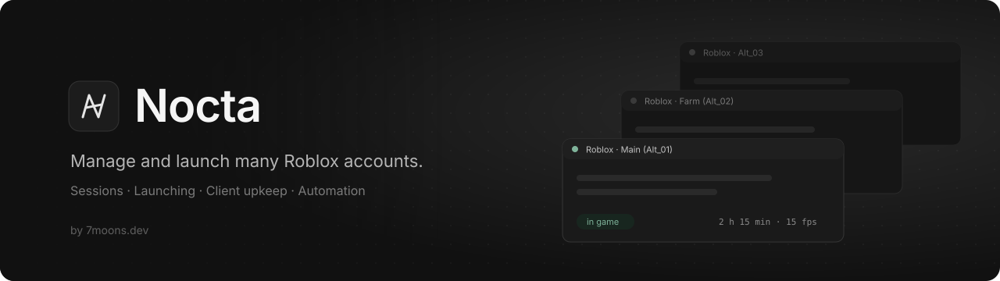
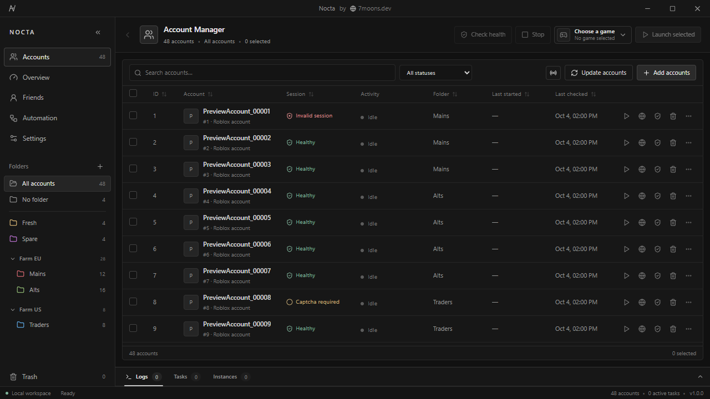
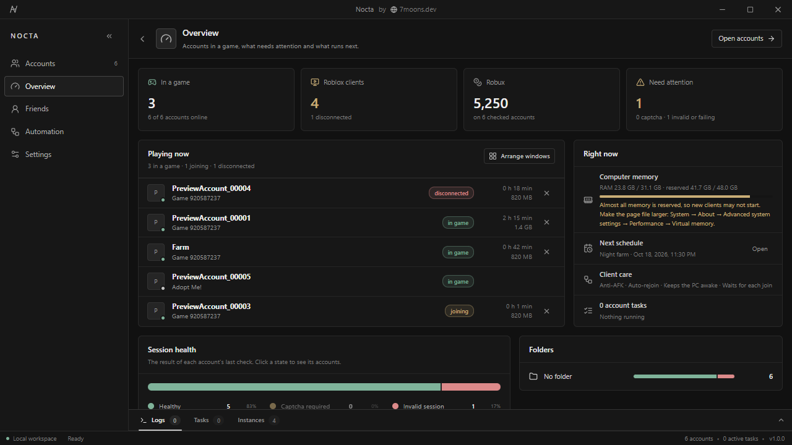
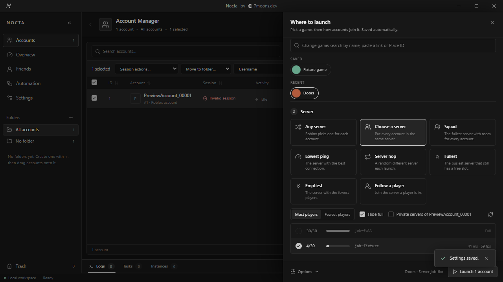
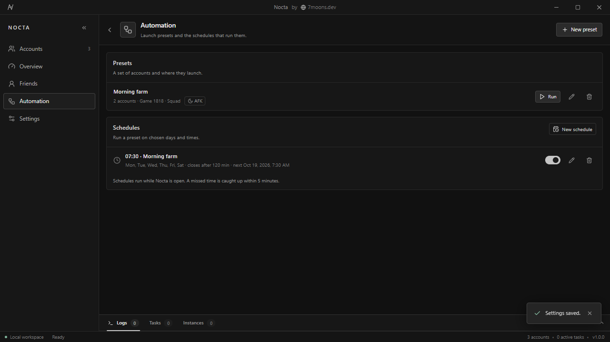
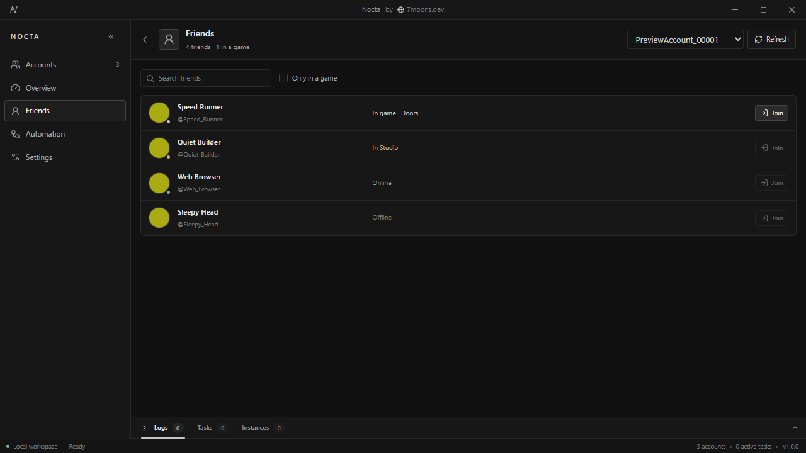
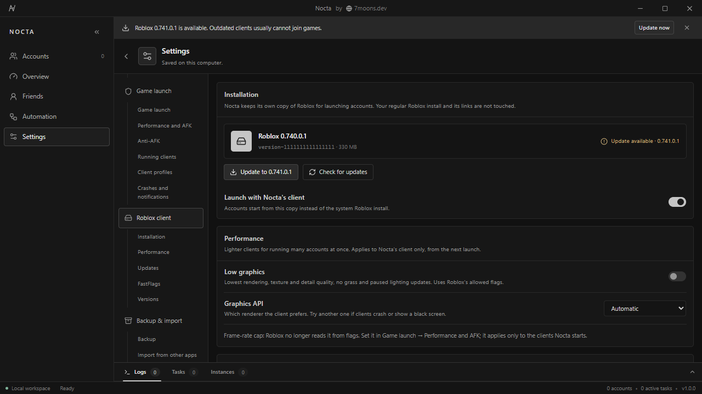
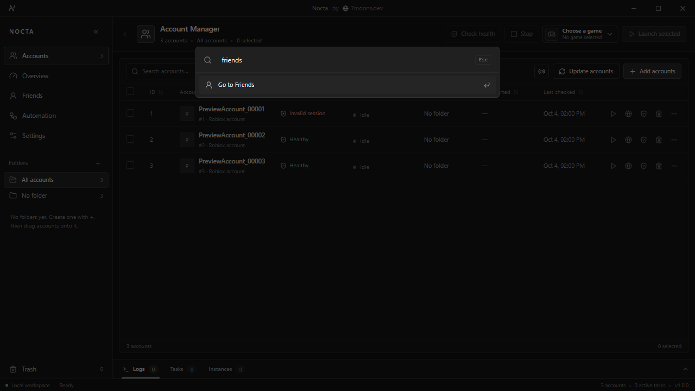
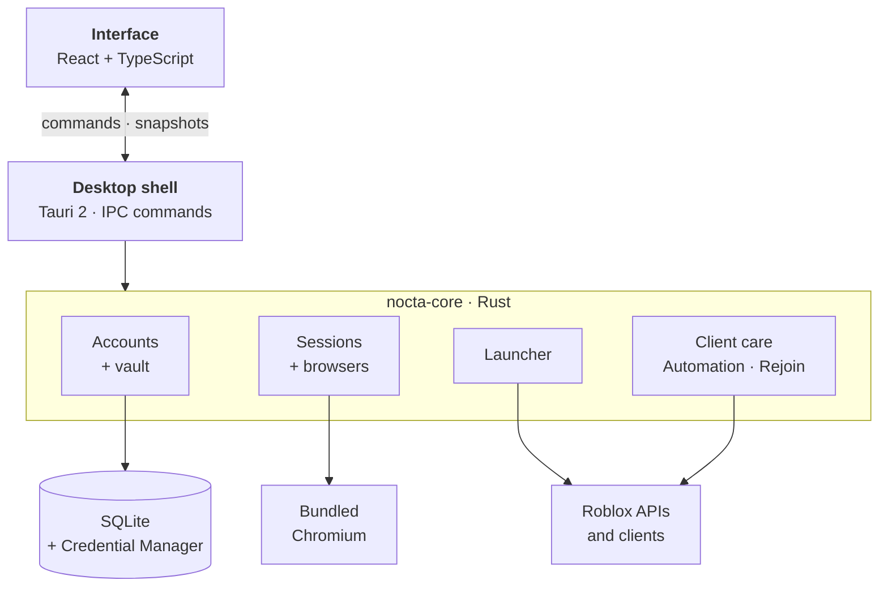
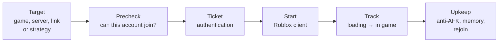

<p align="center">
  
</p>

<p align="center">
  <a href="LICENSE"></a>
  
  
  
  
  
</p>

<p align="center">
  <a href="#features">Features</a> ·
  <a href="#screenshots">Screenshots</a> ·
  <a href="#getting-started">Getting started</a> ·
  <a href="#how-it-works">How it works</a> ·
  <a href="#documentation">Documentation</a>
</p>

---

**Nocta** is a desktop app for running many Roblox accounts. It stores the accounts and their
sessions, checks which sessions still work, and launches accounts into a game, all at once or one
by one, each in its own Roblox window. While the clients run, it keeps them from being kicked for
idling, limits their memory and restarts the ones that crash.

Data stays on your computer. Passwords, cookies and two-step keys are encrypted with a key kept in
Windows Credential Manager. Nocta connects only to Roblox, and to a Discord webhook if you set one.

<p align="center">
  
</p>

## Highlights

<table>
  <tr>
    <td width="33%" valign="top">
      <h3>Accounts</h3>
      Import <code>username:password:cookie</code> lines with a preview, sort them into folders,
      search and filter by session state. Tested with 10,000 accounts.
    </td>
    <td width="33%" valign="top">
      <h3>Launching</h3>
      Search a game or paste a link, then pick a server or a strategy: room for every account, lowest
      ping, a hop, fullest or emptiest, one region, or the server a friend is in.
    </td>
    <td width="33%" valign="top">
      <h3>Memory and CPU</h3>
      A RAM cap per client (939 MB → 350 MB measured in a game), memory trimming, efficiency mode, a
      frame-rate cap and windows down to 1×1 pixel.
    </td>
  </tr>
  <tr>
    <td valign="top">
      <h3>Upkeep and schedules</h3>
      Anti-AFK before Roblox's 20-minute kick, auto-rejoin after crashes with Discord notices, and
      schedules that start and stop groups of accounts on chosen days.
    </td>
    <td valign="top">
      <h3>Separate Roblox install</h3>
      A Roblox copy of its own with version pinning, update control, a low-graphics mode and a
      FastFlag editor limited to Roblox's allowlist. Your regular Roblox install is not changed.
    </td>
    <td valign="top">
      <h3>Encryption</h3>
      Secrets are encrypted with AES-256-GCM, backups with a key derived from their password
      (Argon2id). Stored secrets are never sent to the interface.
    </td>
  </tr>
</table>

## Features

### Accounts

- Import accounts in bulk with a preview, or add one by signing in on Roblox's own page.
- Folders and folder groups in the sidebar: create and rename them in place, set colors and groups
  from the menu (right click or ⋯), reorder folders and drop accounts onto them.
- Your own account order by drag and drop, aliases, notes, color tags, pins and named fields
  ("Server: EU") that search finds too.
- Avatars, online status, Robux and playtime per account, plus two-step verification codes.
- Copy accounts in formats you define (copied credentials are cleared after 30 seconds), export
  them to CSV or JSON, and restore them from Trash.
- Streamer mode hides usernames, Roblox IDs and avatars.

### Sessions

- Check which sessions still work, validate and refresh cookies, and fix expired or long-unchecked
  ones in one click.
- Open any account in its own signed-in browser, titled with the account's name.
- When Roblox wants a captcha, the account is marked and its browser is where you clear it.

### Launching

- Find a game by name or paste a Roblox link, including share links and private servers.
- Pick a server yourself from the server browser, or let Nocta choose: squad, lowest ping, server
  hop, fullest, emptiest, a region, or the server a player is in.
- Accounts start one after another, each once the previous one is in its game.
- Every client Nocta starts is tracked: loading, joining, in game, or disconnected with Roblox's
  reason.

### Client upkeep

| | |
| --- | --- |
| **Anti-AFK** | Presses a key (or clicks a point) in idle clients before the 20-minute kick, waiting while you type. |
| **Auto-rejoin** | Brings back clients that crashed or were disconnected, with optional Discord webhook notices. |
| **Memory** | A RAM cap per client, regular trimming and low memory priority. Measured in a game: 939 MB without a cap, 350 MB with one. |
| **CPU** | Process priority, efficiency mode (EcoQoS) and a CPU limit, separately for main accounts and the others. |
| **Frame rate** | A frame-rate cap and an AFK profile. The cap reaches only the clients Nocta starts; Roblox you open yourself keeps your own setting. |
| **Windows** | Named after their account, arranged in a grid across monitors, and resizable down to one pixel, also by dragging the border. |
| **Restarts** | Frozen clients are closed and rejoin; other accounts can restart on a timer while main accounts keep running. |

### Automation

- Launch presets (accounts, destination and AFK) with optional system-wide shortcuts.
- Schedules that run presets on chosen days and close what they started later.
- Command line: `nocta --preset "<name>"` or `nocta --launch <place or link> --accounts a,b`.

### Roblox account tools

- Sign an account out of every other device (Nocta keeps the new cookie).
- Change display names and privacy, also one setting on many accounts at once.
- Approve a Quick Login code after checking the device.
- Make your own accounts friends: everyone with everyone, or with one main account.

### And more

- **Command palette** (<kbd>Ctrl</kbd>+<kbd>K</kbd>) for views, presets, accounts and actions, plus
  global shortcuts, a tray icon and starting with Windows.
- **Multi-instance** on Windows, so several Roblox clients run side by side.
- **Themes**: Catppuccin, Dracula, Nord, Gruvbox, Tokyo Night, Rosé Pine, One Dark and more, with a
  live theme editor for your own.
- **Backups** protected with a password, and importers for the previous Nocta app and ic3w0lf's
  Roblox Account Manager (`AccountData.json`, password-protected files included).
- **Safe display mode** restarts Nocta without GPU acceleration when a graphics driver leaves the
  window blank.
- **Eight languages**: English, Polish, German, Spanish, French, Portuguese (Brazil), Turkish and
  Russian.

## Screenshots

<table>
  <tr>
    <td width="50%"><br><sub><b>Overview</b>: accounts in a game, memory, the next schedule and accounts that need attention.</sub></td>
    <td width="50%"><br><sub><b>Launch panel</b>: a game, a join strategy and the live server list.</sub></td>
  </tr>
  <tr>
    <td><br><sub><b>Automation</b>: presets and the schedules that run them.</sub></td>
    <td><br><sub><b>Friends</b>: where each account's friends are, and joining them.</sub></td>
  </tr>
  <tr>
    <td><br><sub><b>Roblox client</b>: Nocta's own install, updates and performance settings.</sub></td>
    <td><br><sub><b>Command palette</b> (Ctrl+K): views, presets, accounts and actions by name.</sub></td>
  </tr>
</table>

## Getting started

### Install (Windows 10 and 11)

Download from the [latest release](https://github.com/7moons/nocta/releases/latest):

| File | Notes |
| --- | --- |
| `Nocta_<version>_x64-setup.exe` | per-user installer, about 160 MB |
| `Nocta-<version>-windows-x64-portable.zip` | no installer, about 220 MB |
| `SHA256SUMS.txt` | checksums of the two files above |

- **Why 160 MB.** Nocta carries its own copy of Chrome for session checks and logins, so it never
  touches your own browser profile.
- **SmartScreen.** The installer is not code-signed yet, so Windows asks once on first run.
- **No automatic updates.** Nocta does not update itself yet. Watch the
  [releases](https://github.com/7moons/nocta/releases) page for new versions.
- **Verify a download.** Compare it with `SHA256SUMS.txt`, or check its build provenance:

  ```powershell
  gh attestation verify Nocta_<version>_x64-setup.exe --repo 7moons/nocta
  ```

Questions and ideas are welcome in [Discussions](https://github.com/7moons/nocta/discussions).

### Requirements

| Requirement | Version |
| --- | --- |
| Windows | 10 or 11 |
| [Bun](https://bun.sh) | 1.3 |
| [Rust](https://rustup.rs) | 1.93 |
| [Tauri prerequisites](https://tauri.app/start/prerequisites/) | for your system |

### Run from source

```bash
bun install --frozen-lockfile
bun run desktop
```

`bun run dev` serves only the interface at http://127.0.0.1:5173, as a read-only preview with
sample data (`?benchmark=10000` fills it with 10,000 sample accounts).

Session checks and logins use a bundled Chromium in `runtime/chrome`, not your own browser;
[Operations](docs/operations.md#browser-runtime) explains how to stage it. Release builds are made
with `bun run release`.

## How it works

Nocta has three layers. The interface does not access data or processes: it renders a snapshot
of the backend's state and requests changes through a fixed list of commands.



A launch goes through the same steps for every account:



[Architecture](docs/architecture.md) goes into the modules, how data and secrets are stored, and
the decisions behind them.

### Project layout

```text
crates/nocta-core   Domain logic in Rust: storage, accounts, sessions, launching, client care
src-tauri           Desktop shell: window, app state, IPC commands
src                 React interface: app shell, one folder per feature, i18n, themes, styles
tests/ui            Playwright tests of the interface against a mocked backend
scripts             Releases, runtime staging and native smoke tests
docs                Architecture, operations, testing, design and decision records
```

## Development

Every pull request runs these checks on Windows:

```bash
cargo fmt --all -- --check
cargo clippy --workspace --all-targets -- -D warnings
cargo test -p nocta-core
bun run lint && bun run format:check
bun run build
bun run test
```

[Contributing](CONTRIBUTING.md) covers conventions, contracts between Rust and TypeScript, and
adding translations. [Testing](docs/testing.md) lists every suite, including the ones that talk to
real Roblox and are run by hand.

## Documentation

| | |
| --- | --- |
| [Changelog](CHANGELOG.md) | What changed in each version; also under the version number in the app's status bar. |
| [Architecture](docs/architecture.md) | How the core, the desktop shell and the interface fit together; data and secrets. |
| [Operations](docs/operations.md) | Data location, portable mode, backups, the browser runtime and releases. |
| [Testing](docs/testing.md) | Every test suite and how to run it. |
| [Feature parity](docs/account-manager-parity.md) | Features taken over from Roblox Account Manager and the tests behind them. |
| [Design](docs/design.md) | Visual direction, themes and the main workflows. |
| [Contributing](CONTRIBUTING.md) | Setting up, conventions and translations. |
| [Security](SECURITY.md) | Reporting vulnerabilities and how secrets are handled. |

## Disclaimer

Nocta is not affiliated with or endorsed by Roblox Corporation. Automating accounts can break
Roblox's terms of service; you are responsible for how you use it.

## License

[GPL-3.0](LICENSE) · Made by [7moons](https://7moons.dev)
